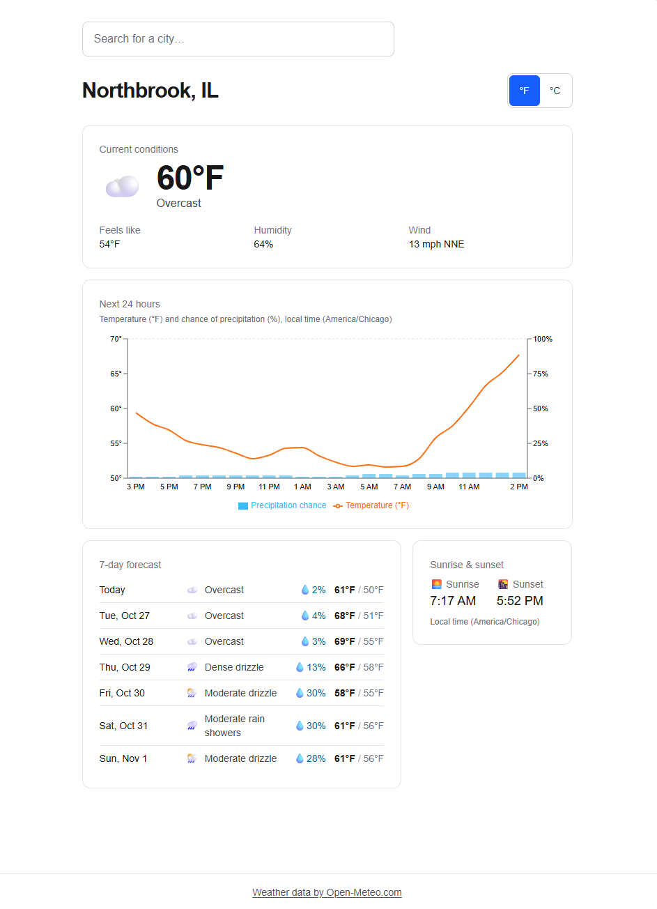
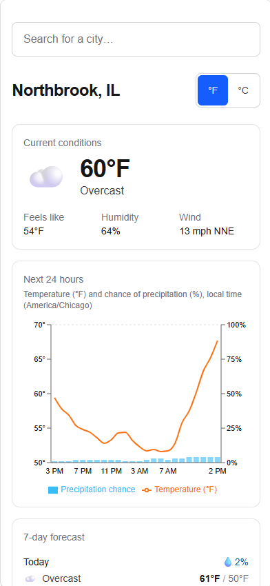

# Capstone Weather App

A mobile-first weather dashboard built with Next.js (App Router), TypeScript, Tailwind CSS,
and Recharts, using forecast and geocoding data from [Open-Meteo](https://open-meteo.com/).
It is hosted on Azure App Service (Linux, Node 22 LTS) as a Next.js standalone build.

## Prerequisites

- Node.js 22 LTS and npm
- For deploying: an Azure subscription, the [Azure CLI](https://learn.microsoft.com/cli/azure/install-azure-cli),
  `zip`, and `curl` (bash on Linux, macOS, or WSL)

No API keys are needed.

## Local development

```bash
npm ci
npm run dev
```

Open [http://localhost:3000](http://localhost:3000). To run the production build locally:

```bash
npm run build
npm start
```

## Tests

```bash
npm test        # Vitest unit and route tests (offline)
npm run lint    # ESLint
```

## Dashboard

The home page shows current conditions, a 24-hour temperature/precipitation chart, a 7-day
outlook, and sunrise/sunset for the location in the URL. Location and units live in the
query string, so every view is shareable:

| URL | Shows |
| --- | --- |
| `/` | Northbrook, IL (42.128, -87.829), imperial |
| `/?lat=40&lon=-75` | Those coordinates, labeled `40.000, -75.000` |
| `/?lat=51.50853&lon=-0.12574&name=London%2C+England%2C+United+Kingdom&units=metric` | London in °C and km/h |
| `/?units=kelvin` | Unsupported units fall back to imperial (°F, mph) |

Invalid or missing coordinates fall back to Northbrook, IL. The °F/°C control changes only the
`units` parameter (keeping `lat`, `lon`, `name`, and anything else); selecting a location
from search keeps the current `units`. Hourly labels and sun times use the forecast
location's local clock, not the browser's timezone.

### Screenshots





### Checking the dashboard locally

Server components fetch forecasts on the server, so browser request mocking cannot control
them. For deterministic checks, start a local server with the validation-only harness
[`scripts/mock-open-meteo.mjs`](scripts/mock-open-meteo.mjs). It is never imported by the
app; it wraps `fetch` only in the process you start this way, serves forecasts derived from
`tests/fixtures/forecast.json`, and re-reads `/tmp/open-meteo-mock.json` on every request:

```bash
npm run build
echo '{"mode":"ok","delayMs":0}' > /tmp/open-meteo-mock.json
NODE_OPTIONS="--import ./scripts/mock-open-meteo.mjs" npx next start -p 3100
```

Longitudes between -30 and 40 are served as Europe/London (cooler, earlier sunset), so
location switches are visible. Successful forecasts are cached for 10 minutes per
coordinates/units, so use fresh coordinates (e.g. `?lat=12.3&lon=45.6`) when testing
loading or failures.

1. **Location refresh:** open `/?units=metric`, search "London", and select it. The URL
   keeps `units=metric`; the heading, current card, chart, 7-day list, and sun times all
   switch to London (`Local time (Europe/London)`, sunset 4:38 PM).
2. **Unit refresh:** press °C/°F (mouse, or Tab + Enter/Space). Current, feels-like,
   chart axis/tooltip, daily highs/lows, and wind change together; Back/Forward restore
   the matching view and pressed button.
3. **Loading:** set `{"mode":"ok","delayMs":5000}` and open new coordinates. Skeletons
   (no numbers) appear and the Open-Meteo attribution stays visible.
4. **Error and retry:** set `{"mode":"fail"}` and open new coordinates. A friendly banner
   with **Try again** appears (no stack trace or provider text); the server log shows the
   `OpenMeteoError`. Set `{"mode":"ok"}` and press **Try again**: the same URL renders.
5. **Timezones and midnight:** set `{"mode":"ok","currentTime":"2026-10-26T23:45"}` with
   new coordinates; the chart starts at 12 AM. Emulate another browser timezone in
   DevTools (Sensors → Location) and confirm hours and sun times do not change. Add
   `"nullSunrise":true` to see "Unavailable", or `"weatherCode":96` to force a long
   condition label.
6. **375px:** in DevTools device mode at 375px wide, with a long `name=` value, check the
   success, loading, and error states: `document.documentElement.scrollWidth <=
   document.documentElement.clientWidth`, and the chart axes, °F/°C control, all seven
   daily rows, sun times, and attribution are readable.

In the DevTools Network panel, the browser should make no requests to `open-meteo.com` and
none to `/api/forecast`; forecast data arrives in the server-rendered payload.

## Weather data

Forecasts and geocoding come from [Open-Meteo](https://open-meteo.com/) (no API key,
[CC BY 4.0](https://creativecommons.org/licenses/by/4.0/)). Every page shows
"Weather data by Open-Meteo.com". Only the server calls Open-Meteo, through
`lib/openmeteo.ts`; the browser never requests an Open-Meteo host.

### Normalized forecast

`getForecast(lat, lon, units)` requests `https://api.open-meteo.com/v1/forecast` with
`timezone=auto`, `forecast_days=7`, and these fields:

| Group | Provider fields |
| --- | --- |
| current | `temperature_2m`, `apparent_temperature`, `relative_humidity_2m`, `wind_speed_10m`, `wind_direction_10m`, `weather_code`, `is_day` |
| hourly | `temperature_2m`, `precipitation_probability`, `weather_code` |
| daily | `weather_code`, `temperature_2m_max`, `temperature_2m_min`, `precipitation_probability_max`, `sunrise`, `sunset` |

Imperial requests add `temperature_unit=fahrenheit`, `wind_speed_unit=mph`, and
`precipitation_unit=inch`; metric uses provider defaults (°C, km/h, mm). A response whose
reported units disagree with the requested system is rejected rather than relabeled.

The provider's parallel arrays are mapped to `Forecast` (`lib/types.ts`). For the recorded
metric fixture (`GET /api/forecast?lat=38.63&lon=-90.2&units=metric`) the result is:

```jsonc
{
  "timezone": "America/Chicago",
  "units": { "system": "metric", "temperature": "°C", "windSpeed": "km/h", "precipitation": "mm" },
  "current": { "time": "2026-10-26T13:30", "temperature": 23.5, "apparentTemperature": 23.2,
               "humidity": 44, "windSpeed": 5.6, "windDirection": 230, "weatherCode": 0, "isDay": true },
  "hourly": [ { "time": "2026-10-26T14:00", "temperature": 23.9, "precipitationProbability": 1, "weatherCode": 0 } /* 24 points */ ],
  "daily": [ { "date": "2026-10-26", "weatherCode": 3, "temperatureMax": 24.7, "temperatureMin": 10.7,
               "precipitationProbabilityMax": 1, "sunrise": "2026-10-26T07:21", "sunset": "2026-10-26T18:07" } /* 7 days */ ]
}
```

Imperial responses have the same shape with `"system": "imperial"`, `°F`, `mph`, and `in`.

- Times are the forecast location's local clock (`YYYY-MM-DDTHH:mm`, no offset); `timezone`
  is the provider's IANA zone.
- Missing measurements and sun events are `null` (shown as "Unavailable" or chart gaps), never `0`.
- **Hourly slicing:** the 24 points start at the first hourly timestamp **>= `current.time`**,
  compared as local strings. Current time `14:00` starts at `14:00`; `14:15` starts at
  `15:00`; `23:45` starts at the next day's `00:00`. No match or fewer than 24 remaining
  points is an unusable response.
- Missing/misaligned arrays, malformed timestamps, non-numeric values, or anything other
  than 7 daily entries raise `OpenMeteoError` rather than returning a partial forecast.
- **Connection retries:** each Open-Meteo request attempt (forecast and geocoding) is capped at
  3 s, and network/timeout failures are retried up to 3 attempts in total. HTTP error statuses and
  unusable payloads are not retried. This covers occasional stalled TCP connects from Azure
  App Service, which would otherwise wait for Node's 10 s connect timeout and fail.
- **Caching:** forecast fetches use `next: { revalidate: 600 }` (ten minutes), keyed by the
  request URL (coordinates and units). Geocoding uses `revalidate: 86400`.
- Weather codes map to labels and emoji in `lib/wmo.ts` (all 28 Open-Meteo WMO codes, with
  night variants for clear/mainly clear/partly cloudy; unknown codes show "Unknown conditions").

Adapter tests use a recorded, unedited response in
[`tests/fixtures/forecast.json`](tests/fixtures/README.md) and run offline.

## API

### `GET /api/forecast?lat=&lon=&units=`

```bash
curl "http://localhost:3000/api/forecast?lat=42.128&lon=-87.829"               # imperial (default)
curl "http://localhost:3000/api/forecast?lat=51.50853&lon=-0.12574&units=metric"
```

| Case | Status | Body |
| --- | --- | --- |
| Success | 200 | `Forecast` object (above), unwrapped |
| Missing, blank, non-numeric, non-finite, or out-of-range `lat` (±90) / `lon` (±180) | 400 | `{ "error": "Provide valid coordinates: …" }` |
| `units` present but not exactly `imperial` or `metric` (including empty) | 400 | `{ "error": "Units must be imperial or metric." }` |
| Provider unreachable, non-2xx, invalid JSON, or unusable payload | 502 | `{ "error": "Weather forecast is unavailable. Please try again." }` |

Omitted `units` defaults to `imperial`. For repeated parameters the first value wins.
Invalid requests never contact the provider, and 502 bodies never include provider details.

### `GET /api/geocode?q=`

Returns `{ "results": Location[] }` for 2–100 character queries; 400 otherwise, 502 on
upstream failure.

### `GET /api/health`

Liveness check used by the deploy script. Always `200 { "status": "ok" }` with
`Cache-Control: no-store`; it does not call Open-Meteo.

```bash
curl -i http://localhost:3000/api/health
```

## Deploy to Azure

```bash
az login
./scripts/deploy.sh
```

The script checks that the Azure CLI is installed and logged in, then runs
`scripts/package.sh` to build the standalone output and zip it to `app.zip`. It then
creates the resource group, App Service plan, and web app if
they don't exist, configures the app (no build on Azure, startup command `node server.js`,
HTTPS only), zip-deploys, and waits up to 3 minutes for `/api/health` to return 200. It
prints the app URL on success and exits non-zero on any failure.


| Variable | Default | Purpose |
| --- | --- | --- |
| `APP` | `capstone-weather-app` | Web app name; becomes `https://<APP>.azurewebsites.net` |
| `RG` | `rg-capstone-weather-app` | Resource group |
| `LOC` | `centralus` | Azure region |
| `PLAN` | `plan-capstone-weather-app` | App Service plan (always Linux, `B1`) |

Web app names are global across Azure. If the default is taken, the script stops before
building or creating anything and asks for another name:

```bash
APP=my-weather-1234 ./scripts/deploy.sh
```

Re-running the script is safe: existing resources are reused, the settings are re-applied,
and the new build replaces the old one. Use the same variables each time.

### Package only

To build the deploy package without Azure (needs Node 22, npm, and `zip`):

```bash
./scripts/package.sh
unzip -l app.zip | grep -E ' (server\.js|public/|\.next/static/)$'
```

It runs `npm ci` and `npm run build`, then writes `app.zip` at the repository root. If the
build fails, it exits non-zero and leaves no `app.zip` behind.

## CI/CD

GitHub Actions checks every pull request and deploys `main` to the existing Azure web app.

### Pull request checks

[`.github/workflows/ci.yml`](.github/workflows/ci.yml) (workflow `CI`, job `ci`) runs on
every pull request with Node 22: `npm ci`, `npm run lint`, `npm test`, and `npm run build`.
If any step fails, the check fails. A newer push to the same pull request cancels the
older run.

To stop pull requests with failing checks from merging, require the `ci` check on `main`.
In **Settings → Branches** (or **Settings → Rules → Rulesets**), add a rule for `main`,
enable **Require status checks to pass**, and select `ci`. The check only appears in the
list after it has run once, so open a pull request first. Or use the GitHub CLI (this
replaces any existing protection on `main`):

```bash
gh api -X PUT repos/gno3/capstone-weather-app/branches/main/protection --input - <<'EOF'
{
  "required_status_checks": { "strict": true, "contexts": ["ci"] },
  "enforce_admins": false,
  "required_pull_request_reviews": null,
  "restrictions": null
}
EOF
```

### Deploying `main`

[`.github/workflows/deploy.yml`](.github/workflows/deploy.yml) (workflow `Deploy`) runs on
every push to `main` and on manual runs. It:

1. Fails right away if the run is not on `main`, or if any secret or variable below is
   missing (naming each missing one).
2. Runs `npm ci`, `npm run lint`, and `npm test`, then `./scripts/package.sh` (which builds).
   If any of these fail, nothing is uploaded.
3. Signs in to Azure with OpenID Connect (no client secret or publish profile), reads the
   web app's host name, and zip-deploys `app.zip` with `az webapp deploy`.
4. Polls `https://<host>/api/health` for up to 3 minutes. The run passes only if it gets
   HTTP 200, and the app URL is written to the run summary.

The pipeline never creates Azure resources and never changes app settings or site
configuration. **Run `./scripts/deploy.sh` once first** to provision and configure the
web app; if the app does not exist, the `Deploy` run fails without creating anything.

| Name | Kind | Holds |
| --- | --- | --- |
| `AZURE_CLIENT_ID` | Secret | Application (client) ID of the app registration used to sign in |
| `AZURE_TENANT_ID` | Secret | Microsoft Entra tenant ID |
| `AZURE_SUBSCRIPTION_ID` | Secret | Subscription that contains the web app |
| `APP` | Variable | Web app name, the same `APP` used with `deploy.sh` |
| `RG` | Variable | Resource group of the web app, the same `RG` used with `deploy.sh` |

Add them under **Settings → Secrets and variables → Actions** (secrets on the **Secrets**
tab, `APP` and `RG` on the **Variables** tab).

#### One-time Azure setup

Run these once, logged in with `az login` as someone who can create app registrations and
assign roles on the web app. Use the same `APP` and `RG` as `deploy.sh`:

```bash
APP=capstone-weather-app RG=rg-capstone-weather-app

# App registration and service principal for GitHub Actions
appId=$(az ad app create --display-name "gh-capstone-weather-app-deploy" --query appId -o tsv)
az ad sp create --id "$appId" -o none

# Trust GitHub's OIDC tokens for this repository's main branch only. The subject prefix
# comes from GitHub: newer repositories use immutable IDs
# (repo:gno3@<owner-id>/capstone-weather-app@<repo-id>), older ones use
# repo:gno3/capstone-weather-app. It must match exactly, or sign-in fails with AADSTS700213.
prefix=$(gh api repos/gno3/capstone-weather-app/actions/oidc/customization/sub --jq .sub_claim_prefix)
az ad app federated-credential create --id "$appId" --parameters "{
  \"name\": \"github-main\",
  \"issuer\": \"https://token.actions.githubusercontent.com\",
  \"subject\": \"$prefix:ref:refs/heads/main\",
  \"audiences\": [\"api://AzureADTokenExchange\"]
}"

# Website Contributor on this one web app (can deploy; cannot create plans or groups)
az role assignment create --assignee "$appId" --role "Website Contributor" \
  --scope "$(az webapp show -g "$RG" -n "$APP" --query id -o tsv)"

# Repository secrets and variables
gh secret set AZURE_CLIENT_ID --body "$appId"
gh secret set AZURE_TENANT_ID --body "$(az account show --query tenantId -o tsv)"
gh secret set AZURE_SUBSCRIPTION_ID --body "$(az account show --query id -o tsv)"
gh variable set APP --body "$APP"
gh variable set RG --body "$RG"
```

Role assignments can take a few minutes to take effect.

#### Running and queueing deploys

To deploy without pushing, open **Actions → Deploy → Run workflow** and pick `main`, or run:

```bash
gh workflow run Deploy --ref main
```

Runs on any other branch fail with "Only main can be deployed". Only one deploy runs at a
time (concurrency group `deploy-production`). A run that starts while another is in
progress waits for it and never cancels it. GitHub keeps at most one waiting run, so
after several quick pushes the newest one replaces the older waiting run, and the final
deploy is still the latest `main`.

To turn off automatic deploys, disable the `Deploy` workflow in the Actions tab;
`./scripts/deploy.sh` keeps working as before.

## Teardown

```bash
./scripts/teardown.sh                 # or RG=<your-group> ./scripts/teardown.sh
az group exists -n rg-capstone-weather-app   # prints false once deletion finishes
```

The script asks for confirmation (`y`/`yes`), then deletes the whole resource group in
the background. Answering anything else deletes nothing.

## Cost

The B1 Linux App Service plan is billed hourly for as long as it exists, whether or not the
app gets traffic (roughly US$13/month at list price; see
[App Service pricing](https://azure.microsoft.com/pricing/details/app-service/linux/)). Run
the teardown script when you are done to stop charges.

## Data attribution

Weather data by [Open-Meteo.com](https://open-meteo.com/), licensed under
[CC BY 4.0](https://creativecommons.org/licenses/by/4.0/). The attribution is shown on
every page of the app.
